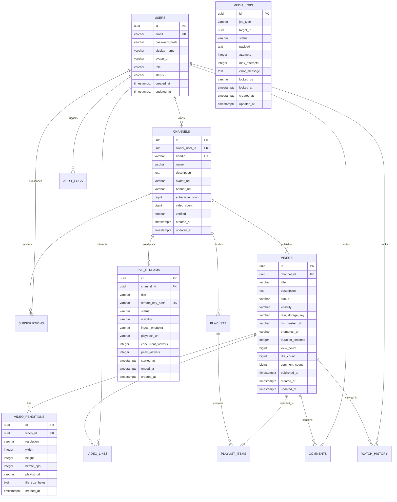

# Super-Emit: Master Architectural Blueprint & System Specification

## Executive Summary

**Super-Emit** is an enterprise-grade video-sharing and live-streaming platform inspired by YouTube, featuring original branding, a high-performance modular monolith control plane, a decoupled media data plane, a **Docker-first development workflow**, and a unified **Nginx reverse-proxy gateway**.

This document establishes the corrected master architectural blueprint across all 14 required dimensions, strictly enforcing:
1. **Docker-First Workflow**: Complete startup and teardown via `docker compose up -d --build` and `docker compose down`. No manual developer commands.
2. **Nginx Unified Gateway**: Same-origin entry point on port 80/443 serving the React SPA, routing `/api/`, upgrading `/ws/`, proxying `/swagger-ui/` and `/v3/api-docs/`, and streaming `/media/`.
3. **Java-Only Media Worker**: Zero Python scripts (`worker.py` deleted). FFmpeg and `ffprobe` are orchestrated strictly through Java 25 `ProcessBuilder` and the AWS S3 SDK.
4. **Zero Shell Scripts**: No custom `.sh` startup/shutdown scripts required. Native Dockerfile `ENTRYPOINT` and Compose health checks are utilized.
5. **Safe Lombok Architecture**: `@Data` and `@Builder` on DTOs; `@Getter`, `@Setter`, and explicit ID equality on JPA entities (avoiding lazy-load proxy recursion and secret exposure); `@RequiredArgsConstructor` for constructor injection; `@Slf4j` for logging.
6. **Springdoc OpenAPI / Swagger UI**: Fully documented REST endpoints grouped by functional module with Bearer token authentication.

---

## 1. High-Level Architecture Diagram

```mermaid
flowchart TD
    subgraph Clients["Clients & Broadcasters"]
        Browser["Web Client (React 19 + TypeScript)"]
        OBS["Broadcaster (OBS Studio / vMix / FFmpeg)"]
    end

    subgraph Gateway["Nginx Reverse Proxy & Static Web Gateway (:80 / :443)"]
        Nginx["Nginx Gateway"]
    end

    subgraph ControlPlane["Control Plane (Spring Boot Modular Monolith - Java 25)"]
        SecurityGateway["Spring Security Filter Chain & JWT Validator"]
        IdentityMod["Module Identity & Access (RBAC, BCrypt)"]
        ChannelMod["Module Channel (Profiles, Subscriptions)"]
        CatalogMod["Module Catalog (Videos, Renditions, Playback)"]
        UploadMod["Module Upload (Presigned S3 Signer & Complete)"]
        OrchMod["Module Orchestration (Job State Machine & Outbox)"]
        LiveMod["Module Live (Sessions, Stream Keys, Webhooks)"]
        ChatMod["Module Chat (STOMP WebSocket & Room Presence)"]
        SwaggerMod["Springdoc OpenAPI / Swagger UI Engine"]
    end

    subgraph MediaPlane["Media Plane (Decoupled Infrastructure)"]
        MediaMTX["MediaMTX Live Ingest Server (RTMP :1935, SRT :8890, LL-HLS :8888)"]
        JavaWorker["Java Media Transcode Worker (Kafka Consumer + FFmpeg ProcessBuilder)"]
    end

    subgraph Storage["Data & Object Stores"]
        Postgres[("PostgreSQL 16 (Primary Transactional DB)")]
        Redis[("Redis 7 (Presence, Cache, Rate Limits)")]
        Kafka[("Apache Kafka KRaft (Media Job & Event Topics)")]
        MinIORaw[("MinIO / S3: super-emit-raw (Private)")]
        MinIOPublic[("MinIO / S3: super-emit-public (Processed HLS)")]
    end

    %% Client Access via Gateway
    Browser -->|HTTP GET / (Static SPA)| Nginx
    Browser -->|HTTP REST /api/v1/*| Nginx
    Browser -->|WebSocket /ws/*| Nginx
    Browser -->|Swagger Docs /swagger-ui/*| Nginx
    Browser -->|Media Playback /media/*| Nginx

    %% Broadcaster Direct Ingest
    OBS -->|RTMP :1935 / SRT :8890| MediaMTX

    %% Nginx Routing
    Nginx -->|Proxy /api/*, /swagger-ui/*, /v3/api-docs/*| SecurityGateway
    Nginx -->|WebSocket Upgrade /ws/*| ChatMod
    Nginx -->|Proxy /media/* (Cache Segments)| MinIOPublic

    %% Control Plane Security & Routing
    SecurityGateway --> IdentityMod & ChannelMod & CatalogMod & UploadMod & OrchMod & LiveMod & ChatMod & SwaggerMod

    %% Persistence & Messaging
    IdentityMod & ChannelMod & CatalogMod & LiveMod & OrchMod --> Postgres
    ChatMod & SecurityGateway --> Redis
    OrchMod -->|Publish Jobs: superemit.media.vod.jobs| Kafka
    MediaMTX -->|Auth Webhook: POST /api/v1/internal/live/auth| LiveMod

    %% Direct VOD Upload Flow
    Browser -.->|Direct Binary PUT (Presigned URL)| MinIORaw

    %% Java Media Worker Flow
    Kafka -->|Consume Transcode Job| JavaWorker
    JavaWorker -->|Download Raw Binary| MinIORaw
    JavaWorker -->|Execute FFmpeg / ffprobe Subprocess| JavaWorker
    JavaWorker -->|Upload Multi-Bitrate HLS + Posters| MinIOPublic
    JavaWorker -->|Publish Event: superemit.media.vod.events| Kafka
    Kafka -->|Consume Completion Event| OrchMod
    OrchMod -->|Update Video: READY| Postgres
```

---

## 2. Low-Level Module & Package Design

The Java control plane is built as a **Maven multi-module modular monolith**. Each domain is strictly partitioned with clear interfaces, DTOs, and Spring service boundaries:

```
control-plane/
├── common/                               # com.superemit.common
│   ├── dto/                              # ApiResponse<T>, ProblemDetails, Violation, CursorPage<T>
│   ├── entity/                           # BaseEntity (UUID, createdAt, updatedAt)
│   ├── exception/                        # ApiException, GlobalExceptionHandler, ResourceNotFoundException
│   ├── filter/                           # CorrelationIdFilter (MDC tracing & X-Correlation-Id header)
│   └── security/                         # SecurityUser (UserDetails), SecurityUtils
│
├── module-identity/                      # com.superemit.identity
│   ├── controller/                       # AuthController (/api/v1/auth/register, /login, /users/me)
│   ├── dto/                              # RegisterRequest, LoginRequest, AuthResponse, UserDto
│   ├── entity/                           # User (Role: USER/CREATOR/ADMIN, Status: ACTIVE/SUSPENDED)
│   ├── repository/                       # UserRepository (findByEmailIgnoreCase)
│   ├── security/                         # SecurityConfig, JwtAuthenticationFilter
│   └── service/                          # AuthService, JwtTokenService (HMAC-SHA256 signed JWTs)
│
├── module-channel/                       # com.superemit.channel
│   ├── controller/                       # ChannelController (/api/v1/channels, /channels/mine)
│   ├── dto/                              # CreateChannelRequest, ChannelDto
│   ├── entity/                           # Channel (handle, name, description, subscriberCount, videoCount)
│   ├── repository/                       # ChannelRepository (findByHandleIgnoreCase, findByOwnerUserId)
│   └── service/                          # ChannelService (create, validate handle, query)
│
├── module-catalog/                       # com.superemit.catalog
│   ├── controller/                       # VideoController (/api/v1/videos/{id}, /feed/home)
│   ├── dto/                              # VideoDto, VideoPlaybackDetailsDto, RenditionDto
│   ├── entity/                           # Video (Status, Visibility, URLs, counters), VideoRendition
│   ├── repository/                       # VideoRepository, VideoRenditionRepository
│   └── service/                          # VideoService (playback resolution, feeds, view increment)
│
├── module-upload/                        # com.superemit.upload
│   ├── controller/                       # UploadController (/uploads/initiate, /{id}/uploads/complete)
│   ├── dto/                              # InitiateUploadRequest, InitiateUploadResponse, CompleteUploadRequest
│   ├── service/                          # StorageService (interface), S3StorageService (AWS SDK v2), UploadService
│
├── module-orchestration/                 # com.superemit.orchestration
│   ├── entity/                           # MediaJob (QUEUED, RUNNING, COMPLETED, FAILED, DLQ)
│   ├── event/                            # VideoUploadedEvent, VideoTranscodedEvent
│   ├── repository/                       # MediaJobRepository
│   └── service/                          # MediaJobDispatcher (Kafka producer), MediaJobConsumer (Kafka listener)
│
├── module-media-worker/                  # com.superemit.worker (Java 25 FFmpeg Transcoding Worker)
│   ├── config/                           # WorkerKafkaConfig, WorkerS3Config
│   ├── consumer/                         # VodTranscodeJobListener (Kafka consumer for VOD transcode jobs)
│   └── service/                          # JavaFfmpegTranscoder (ProcessBuilder executor for ffprobe & ffmpeg)
│
└── control-plane-app/                    # com.superemit.app
    ├── config/                           # OpenApiConfig (Springdoc Swagger UI, Bearer security scheme)
    ├── resources/
    │   ├── db/migration/                 # V1__init_schema.sql (Flyway migrations)
    │   ├── application.yml               # Production & local Docker profile
    │   └── application-test.yml          # Fast in-memory H2 test profile
    └── SuperEmitApplication.java         # Main Spring Boot bootstrapper
```

---

## 3. Safe Lombok Architecture & Rules

| Artifact Type | Permitted Lombok Annotations | Prohibited / Restricted Annotations | Justification & Architectural Guardrail |
| :--- | :--- | :--- | :--- |
| **JPA Entities** (`User`, `Channel`, `Video`, `MediaJob`) | `@Getter`, `@Setter`, `@NoArgsConstructor`, `@AllArgsConstructor` | **NO `@Data`**, **NO `@EqualsAndHashCode`** | `@Data` generates default `equals()` and `hashCode()` methods that inspect all fields. This triggers accidental initialization of lazy-loaded relationships (`FetchType.LAZY`), causes circular reference `StackOverflowError`s, and breaks Hibernate proxy identity. Identity is defined strictly on `id`. |
| **Sensitive Entities** (`User`, `LiveStream`) | `@Getter`, `@Setter`, `@ToString(exclude = {"passwordHash", "streamKeyHash"})` | Default `@ToString` | Exposes hashed passwords, stream keys, or tokens in application logs if logged directly. |
| **Simple DTOs & Payloads** (`RegisterRequest`, `VideoDto`) | `@Data`, `@Builder`, `@NoArgsConstructor`, `@AllArgsConstructor` | None | DTOs are flat value objects without database persistence proxies. `@Data` and `@Builder` are completely safe and reduce boilerplate. |
| **Services & Controllers** | `@RequiredArgsConstructor`, `@Slf4j` | `@AllArgsConstructor` (when non-final fields exist) | Enforces constructor injection on `final` dependencies for immutability and easy unit testing. `@Slf4j` eliminates manual `LoggerFactory.getLogger()` calls. |

---

## 4. PostgreSQL Entity Relationship Design (PostgreSQL 16+)



---

## 5. REST API Contracts & Swagger Strategy

Springdoc OpenAPI (`org.springdoc:springdoc-openapi-starter-webmvc-ui:2.8.5`) is integrated directly into the modular monolith:
- Exposes interactive Swagger UI at `http://localhost/swagger-ui/index.html` via Nginx.
- Exposes raw OpenAPI 3.0 JSON specification at `http://localhost/v3/api-docs`.
- Defines JWT Bearer token authentication scheme globally.
- Organizes endpoints into domain groups: `Authentication`, `Channels`, `Videos`, `Uploads`, `Live Streaming`.

```java
@Configuration
public class OpenApiConfig {
    @Bean
    public OpenAPI superEmitOpenAPI() {
        return new OpenAPI()
            .info(new Info()
                .title("Super-Emit Control Plane API")
                .description("REST API for Super-Emit video-sharing and live-streaming platform")
                .version("v1.0.0"))
            .addSecurityItem(new SecurityRequirement().addList("BearerAuth"))
            .components(new Components()
                .addSecuritySchemes("BearerAuth", new SecurityScheme()
                    .name("BearerAuth")
                    .type(SecurityScheme.Type.HTTP)
                    .scheme("bearer")
                    .bearerFormat("JWT")));
    }
}
```

---

## 6. Frontend Route & Component Architecture

Built with **React 19, TypeScript, and Vite**, served in production through Nginx:
- `/` — Home feed with category filter pills and responsive video card grid.
- `/watch/:videoId` — Video player, channel details, subscribe toggle, likes/dislikes, description, comments, recommendations.
- `/c/:handle` — Channel profile with banner, avatar, video catalog, and subscriber counter.
- `/studio` — Creator Studio dashboard for managing video catalog and live streams.
- Direct-to-storage upload modal with real-time percentage progress bar and byte counter.
- Custom `Hls.js` video player with dynamic resolution quality switcher (Auto, 1080p, 720p, 480p, 360p), scrubber, keyboard shortcuts, volume, and fullscreen controls.

---

## 7. Nginx Reverse-Proxy Architecture

Nginx operates as the unified entry point on port 80/443:
- **Same-Origin Architecture**: Serves built React static assets on `/`, proxies `/api/` to Spring Boot on `control-plane:8080`, and proxies `/media/` to MinIO on `minio:9000`.
- **WebSocket Upgrade**: Proxies `/ws/` for STOMP chat with HTTP Upgrade headers and 24h timeouts.
- **Swagger Documentation**: Proxies `/swagger-ui/` and `/v3/api-docs` directly to the backend.
- **Large Upload Strategy**: Client uploads binary video files directly to MinIO using presigned S3 URLs. When routed through Nginx, `client_max_body_size` is configured to 5000M with request buffering disabled.
- **Caching Policies**: Immutable `.ts` video chunks cached 1 year (`max-age=31536000`); `.m3u8` playlist manifests strictly `no-cache`; API endpoints `no-store`.

---

## 8. Docker Compose Service Design (Docker-First)

The entire application boots and shuts down via platform-independent Docker Compose commands:
- **Start**: `docker compose up -d --build`
- **Stop**: `docker compose down`
- **View Logs**: `docker compose logs -f`
- **Restart**: `docker compose restart`

### Compose Services Inventory:
1. `postgres`: PostgreSQL 16 Alpine with `init-extensions.sql` (`uuid-ossp`, `pg_trgm`).
2. `redis`: Redis 7 Alpine with health check.
3. `kafka`: Apache Kafka 7.6.1 in KRaft mode (no Zookeeper).
4. `minio`: MinIO S3-compatible object storage with web console.
5. `minio-init`: Automated bucket creator (`super-emit-raw`, `super-emit-public`) running standard `mc` commands.
6. `mediamtx`: MediaMTX RTMP/SRT/LL-HLS live ingest server.
7. `control-plane`: Multi-stage build of Java 25 Spring Boot application running as an unprivileged user.
8. `frontend`: Multi-stage build of React 19 SPA served via Nginx on port 80.

---

## 9. Java-Only Media Worker & FFmpeg Execution Design

Per requirements, **no Python scripts (`worker.py`) or shell scripts are used**. The media worker is implemented entirely in Java 25:
- Ingests `VideoUploadedEvent` from Kafka topic `superemit.media.vod.jobs`.
- Downloads raw video file from MinIO `super-emit-raw` using the AWS S3 Java SDK v2.
- Executes `ffprobe` via Java `ProcessBuilder` to validate duration and container integrity.
- Executes `ffmpeg` via Java `ProcessBuilder` to extract poster thumbnails (`poster.jpg`).
- Executes `ffmpeg` multi-bitrate transcode producing 4 HLS quality tiers (`1080p`, `720p`, `480p`, `360p`) with 2.0s closed GOP alignment and master playlist `master.m3u8`.
- Uploads the HLS package to MinIO `super-emit-public/processed/{videoId}/`.
- Emits `VideoTranscodedEvent` to Kafka topic `superemit.media.vod.events`.
- Cleans up scratch directory safely.

---

## 10. Concurrency, Scaling & Reliability Strategy

- **Stateless Control Plane**: Spring Boot pods maintain zero in-memory HTTP sessions; horizontal scaling behind Nginx / ALB.
- **View Count Buffering**: Video views increment in Redis (`HINCRBY video:views {videoId} 1`) and deduplicate via Redis HyperLogLog (`PFADD`). A scheduled task batch-updates PostgreSQL every 30 seconds.
- **STOMP Live Chat Multi-Node Fabric**: Real-time chat messages publish over Redis Pub/Sub so all control plane nodes broadcast to their local WebSocket clients.
- **Decoupled Worker Scaling**: Java FFmpeg workers consume from Kafka partitions and scale independently based on consumer group lag metrics without affecting API responsiveness.

---

## 11. Security & Moderation Plan

- **Dual-Token Authentication**: Short-lived JWT access tokens + HttpOnly, SameSite=Strict refresh cookies with token rotation.
- **Hashed Stream Keys**: Broadcaster stream keys are hashed using Argon2 or SHA-256 in the database. The plaintext key is shown once in Creator Studio.
- **FFmpeg Container Isolation**: Workers run in unprivileged containers with read-only root filesystems and protocol whitelists (`-protocol_whitelist file,crypto,data`) to prevent SSRF and arbitrary file access.
- **Abuse Prevention**: Automated regex profanity filtering on live chat, Redis rate limiters on public endpoints, and comprehensive `audit_logs` tracking administrative actions.

---

## 12. Phase-by-Phase Implementation Roadmap

| Phase | Focus | Deliverables |
| :--- | :--- | :--- |
| **Phase 0** | **Master Blueprint (Current)** | Architecture, ERD, API specs, Nginx routing, Docker Compose design, Java worker design. |
| **Phase 1** | **Docker-First VOD Vertical Slice** | Multi-stage Dockerfiles, Nginx gateway, Springdoc Swagger UI, safe Lombok refactoring, Java FFmpeg worker, React watch page, full `docker compose up -d --build` verification. |
| **Phase 2** | **Live Streaming & Real-Time Chat** | MediaMTX RTMP ingest, stream key auth webhooks, LL-HLS live playback, STOMP/WebSocket chat with Redis Pub/Sub, Creator Studio Live control room. |
| **Phase 3** | **Social & Discovery** | Likes, comments, subscriptions, Home & Trending feeds, full-text search (`pg_trgm`/GIN), playlists, and watch history. |
| **Phase 4** | **Creator Studio & Analytics** | Video management table, view analytics, thumbnail uploads, scrubber storyboard sprites. |
| **Phase 5** | **Moderation & Hardening** | Report queue, automated chat filters, audit logs, rate limiting, CDN caching rules, security audit. |

---

## 13. Dependencies, Risks & Acceptance Criteria

### 13.1 Technology Stack & Compatibility
- **Java**: OpenJDK 25 LTS installed (`25.0.3+9-LTS-195`). Bytecode release configured to `21` for Spring Boot 3.4.x ASM parser compatibility while executing on Java 25 JVM.
- **Spring Boot**: 3.4.3 with Springdoc OpenAPI 2.8.5.
- **Lombok**: 1.18.36 with safe entity/DTO patterns.
- **PostgreSQL**: 16 Alpine with `uuid-ossp` and `pg_trgm`.
- **Redis**: 7 Alpine.
- **Kafka**: Confluent CP-Kafka 7.6.1 (KRaft mode).
- **MinIO**: S3-compatible storage with automated bucket provisioning.
- **Nginx**: 1.27 Alpine as gateway and static SPA server.
- **React**: React 19, Vite 6, TypeScript, HLS.js, Lucide Icons, Axios.

### 13.2 Acceptance Criteria
1. The entire platform starts cleanly via `docker compose up -d --build`.
2. Developer accesses `http://localhost/` and sees the Super-Emit frontend served by Nginx.
3. Developer accesses `http://localhost/swagger-ui/index.html` and sees interactive API documentation.
4. User registers, logs in, creates a channel, uploads a video directly to MinIO, observes Java FFmpeg worker transcoding, and watches the video via adaptive HLS streaming.
5. All automated unit and integration tests pass with zero regressions.

---

## 14. Recommended First Working Vertical Slice

The recommended slice delivers the complete, working **Docker-first VOD lifecycle**:
1. Run `docker compose up -d --build`.
2. Open `http://localhost/` in the browser.
3. Verify Swagger at `http://localhost/swagger-ui/index.html`.
4. Register user `alex@superemit.com` and create channel `@alexrivera`.
5. Upload `.mp4` video directly to MinIO via presigned URL with progress bar.
6. Java FFmpeg worker consumes job from Kafka, executes FFmpeg via `ProcessBuilder`, produces 4 HLS tiers + `master.m3u8` and poster image, and updates video to `READY`.
7. User navigates to `/watch/{videoId}` and streams the video via `CustomHlsPlayer`.
