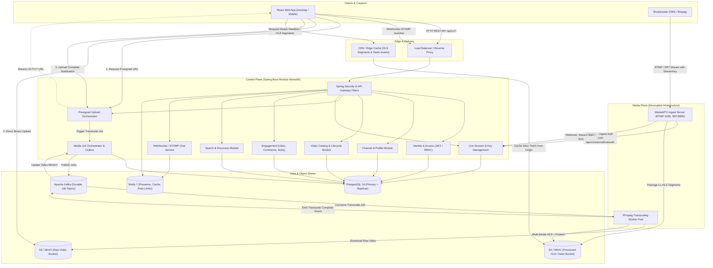
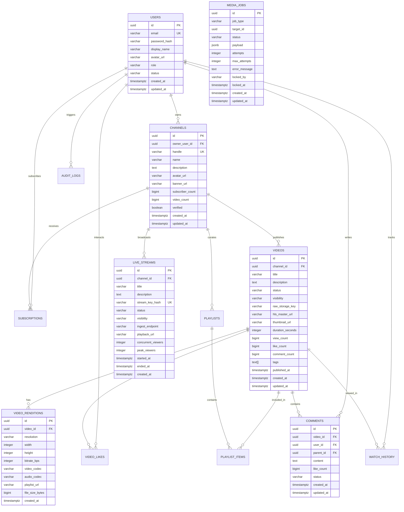
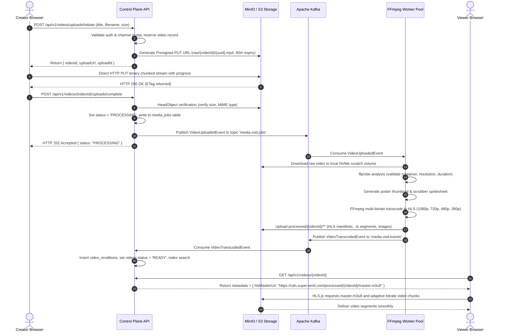

# Super-Emit: Phase-0 Architectural Blueprint & Engineering Specification

## Executive Summary

**Super-Emit** is an enterprise-grade, full-stack video-sharing and live-streaming platform engineered with YouTube-class capabilities, original branding, and an extensible architecture. 

This document defines the **Phase-0 Architecture, Data Model, Media Pipeline, Security Matrix, and Implementation Roadmap**. Per engineering requirements, the control plane and media data plane are strictly decoupled. No video payload bytes traverse the control plane REST API. All heavy media ingestion, transcoding, and packaging are isolated within dedicated media workers and ingest servers.

---

## 1. Architectural Overview & System Topology

### 1.1 Plane Separation & Bounded Contexts

The platform is split into two distinct operational planes:

```
+----------------------------------------------------------------------------------------------------+
|                                         CLIENT APPLICATIONS                                         |
|                 Web (React + TypeScript + Vite)  |  Broadcasting Software (OBS / vMix)             |
+----------------------------------------------------------------------------------------------------+
                   |                                   |                              |
         REST / WebSocket (STOMP)                 RTMP / SRT                     HTTP PUT / GET
                   |                                   |                              |
                   v                                   v                              v
+------------------------------------+  +-----------------------------+  +---------------------------+
|           CONTROL PLANE            |  |         MEDIA PLANE         |  |       STORAGE & CDN       |
|    (Spring Boot Modular Monolith)  |  |    (MediaMTX & FFmpeg)      |  |                           |
|                                    |  |                             |  |                           |
| - Identity, Auth & RBAC            |  | - RTMP/SRT Ingest Server    |  | - MinIO / S3 Raw Bucket   |
| - Channel & Profile Management     |  | - Ingest Auth Webhook Client|  | - MinIO / S3 Public Media |
| - Video Catalog & Lifecycle        |  | - Live LL-HLS Packager      |  | - CDN Edge Cache          |
| - Presigned S3 Upload Signer       |  | - Async FFmpeg VOD Workers  |  |                           |
| - Live Session & Key Management    |  +-----------------------------+  +---------------------------+
| - Live Chat & STOMP Broker         |                 ^                               ^
| - Engagement (Likes, Comments)     |                 |                               |
| - Search & Discovery               |                 +-------- Job Events -----------+
| - Job Orchestration & Outbox       |                           (Kafka Topics)
+------------------------------------+
       |              |             |
       v              v             v
+--------------+ +----------+ +-----------+
|  PostgreSQL  | |  Redis   | |   Kafka   |
| (Relational) | | (Cache)  | |  (Events) |
+--------------+ +----------+ +-----------+
```

### 1.2 End-to-End System Topology Diagram



---

## 2. Repository & Module Structure

The backend uses a **Maven multi-module** design for the control plane. This enforces strict boundary isolation between business domains, prevents circular dependencies, and enables clean future extraction into microservices if scaling demands it.

```
super-emit/
├── pom.xml                                   # Root Maven reactor (BOM, Java 25, compiler & plugin configs)
├── control-plane/                            # Control Plane Parent
│   ├── pom.xml
│   ├── control-plane-app/                    # Bootstrapper: Main class, application.yml, integration test suites
│   ├── common/                               # Core primitives: Result<T>, ErrorResponse, CorrelationFilter, BaseEntity
│   ├── module-identity/                      # User entity, JWT authentication, BCrypt, RBAC, UserDetailsService
│   ├── module-channel/                       # Channel entity, handles, customization, subscriber counts
│   ├── module-catalog/                       # Video entity, metadata, tags, visibility, category taxonomies
│   ├── module-upload/                        # S3 presigned URL generation, upload lifecycle, checksum verification
│   ├── module-orchestration/                 # Kafka producers/consumers, Outbox pattern, media_jobs table state machine
│   ├── module-live/                          # Live session entity, stream key generation/hashing, MediaMTX webhooks
│   ├── module-chat/                          # STOMP over WebSocket, Redis Pub/Sub multi-node broker, chat rate limits
│   ├── module-engagement/                    # Comments, likes/dislikes, watch history, custom playlists
│   ├── module-search/                        # PostgreSQL full-text search (tsvector, GIN index, pg_trgm fuzzy match)
│   ├── module-studio/                        # Creator Studio analytics, video performance metrics, aggregations
│   └── module-moderation/                    # User reports, moderation workflow, audit logging
├── media-plane/
│   ├── ffmpeg-worker/                        # Containerized worker (Java/Go) polling Kafka, executing FFmpeg
│   │   ├── Dockerfile
│   │   ├── scripts/transcode.sh              # FFmpeg multi-bitrate HLS & thumbnail generation script
│   │   └── src/                              # Worker job runner, S3 downloader/uploader
│   └── live-ingest/                          # MediaMTX live streaming server
│       ├── Dockerfile
│       └── mediamtx.yml                      # MediaMTX configuration with HTTP auth hooks to control plane
├── web/                                      # React 19 + TypeScript + Vite SPA
│   ├── package.json
│   ├── vite.config.ts
│   ├── tsconfig.json
│   ├── src/
│   │   ├── api/                              # Axios instance, request/response interceptors, typed client functions
│   │   ├── assets/                           # SVG icons, logos, branded theme assets
│   │   ├── components/                       # Core UI design system (Button, Input, Modal, Dropdown, VideoCard, Skeleton)
│   │   ├── context/                          # AuthContext, ThemeContext, LivePlayerContext
│   │   ├── hooks/                            # useAuth, useDebounce, useVideoPlayer, useWebSocketChat
│   │   ├── layouts/                          # AppLayout (Sidebar, Navbar), StudioLayout, WatchLayout
│   │   ├── pages/                            # HomePage, WatchPage, ChannelPage, StudioPage, LiveStreamPage, SearchPage
│   │   ├── player/                           # Custom HLS.js video player with quality selector, shortcut keys, scrubber
│   │   ├── chat/                             # Real-time live chat panel, emoji picker, moderator actions
│   │   └── types/                            # TypeScript interfaces for API models and events
├── infra/
│   ├── docker-compose.yml                    # Local dev environment (Postgres, Redis, Kafka, MinIO, MediaMTX)
│   ├── postgres/
│   │   └── init-extensions.sql               # Enable 'uuid-ossp' and 'pg_trgm' extensions
│   ├── minio/
│   │   └── setup-buckets.sh                  # Pre-create 'super-emit-raw' and 'super-emit-public' buckets
│   └── mediamtx/
│       └── mediamtx.yml                      # Ingest server configuration
└── docs/
    ├── phase-0-plan.md                       # This comprehensive planning document
    └── api-contracts.md                      # Detailed OpenAPI / REST schemas
```

---

## 3. Database Entity Relationship Design

### 3.1 Relational Schema Architecture (PostgreSQL 16+)

All entities use PostgreSQL-native UUIDs (`uuid_generate_v4()` or UUIDv7) as primary keys to ensure collision-free distributed generation and prevent enumeration attacks. All timestamps are `TIMESTAMP WITH TIME ZONE` (`timestamptz`).



### 3.2 Detailed DDL & Indexing Strategy

1. **`users` Table**:
   - `id UUID PRIMARY KEY DEFAULT gen_random_uuid()`
   - `email VARCHAR(255) NOT NULL UNIQUE`
   - `password_hash VARCHAR(255) NOT NULL`
   - `display_name VARCHAR(100) NOT NULL`
   - `role VARCHAR(32) NOT NULL DEFAULT 'ROLE_USER'` (Checks: `ROLE_USER`, `ROLE_CREATOR`, `ROLE_MODERATOR`, `ROLE_ADMIN`)
   - `status VARCHAR(32) NOT NULL DEFAULT 'ACTIVE'` (Checks: `ACTIVE`, `SUSPENDED`, `DELETED`)
   - Indexes: B-tree on `email`, `status`.

2. **`channels` Table**:
   - `id UUID PRIMARY KEY DEFAULT gen_random_uuid()`
   - `owner_user_id UUID NOT NULL REFERENCES users(id) ON DELETE CASCADE`
   - `handle VARCHAR(60) NOT NULL UNIQUE` (Validated regex: `^[a-zA-Z0-9_.-]+$`)
   - `name VARCHAR(120) NOT NULL`
   - `description TEXT`
   - `subscriber_count BIGINT NOT NULL DEFAULT 0`
   - `video_count BIGINT NOT NULL DEFAULT 0`
   - Indexes: B-tree on `handle`, `owner_user_id`.

3. **`videos` Table**:
   - `id UUID PRIMARY KEY DEFAULT gen_random_uuid()`
   - `channel_id UUID NOT NULL REFERENCES channels(id) ON DELETE CASCADE`
   - `title VARCHAR(255) NOT NULL`
   - `description TEXT`
   - `status VARCHAR(32) NOT NULL DEFAULT 'UPLOAD_INITIATED'` (States: `UPLOAD_INITIATED`, `UPLOADED`, `PROCESSING`, `READY`, `FAILED`, `DELETED`)
   - `visibility VARCHAR(32) NOT NULL DEFAULT 'PUBLIC'` (States: `PUBLIC`, `UNLISTED`, `PRIVATE`)
   - `raw_storage_key VARCHAR(512)`
   - `hls_master_url VARCHAR(512)`
   - `thumbnail_url VARCHAR(512)`
   - `duration_seconds INTEGER DEFAULT 0`
   - `view_count BIGINT NOT NULL DEFAULT 0`
   - `like_count BIGINT NOT NULL DEFAULT 0`
   - `tags TEXT[] DEFAULT '{}'`
   - `tsv TSVECTOR GENERATED ALWAYS AS (to_tsvector('english', coalesce(title,'') || ' ' || coalesce(description,''))) STORED`
   - Indexes:
     - Composite: `CREATE INDEX idx_videos_channel_status ON videos (channel_id, status, published_at DESC);`
     - Full-Text Search: `CREATE INDEX idx_videos_tsv ON videos USING GIN(tsv);`
     - Tag Search: `CREATE INDEX idx_videos_tags ON videos USING GIN(tags);`
     - Trending / Discovery: `CREATE INDEX idx_videos_discovery ON videos (status, visibility, published_at DESC) WHERE status = 'READY' AND visibility = 'PUBLIC';`

4. **`video_renditions` Table**:
   - `id UUID PRIMARY KEY DEFAULT gen_random_uuid()`
   - `video_id UUID NOT NULL REFERENCES videos(id) ON DELETE CASCADE`
   - `resolution VARCHAR(16) NOT NULL` (`1080p`, `720p`, `480p`, `360p`)
   - `width INT NOT NULL`, `height INT NOT NULL`
   - `bitrate_bps INT NOT NULL`
   - `playlist_url VARCHAR(512) NOT NULL`
   - Index: `UNIQUE (video_id, resolution)`

5. **`live_streams` Table**:
   - `id UUID PRIMARY KEY DEFAULT gen_random_uuid()`
   - `channel_id UUID NOT NULL REFERENCES channels(id) ON DELETE CASCADE`
   - `title VARCHAR(255) NOT NULL`
   - `stream_key_hash VARCHAR(128) NOT NULL UNIQUE` (Argon2 or HMAC-SHA256 hash)
   - `status VARCHAR(32) NOT NULL DEFAULT 'IDLE'` (`IDLE`, `LIVE`, `ENDED`, `DISCONNECTED`)
   - `visibility VARCHAR(32) NOT NULL DEFAULT 'PUBLIC'`
   - `ingest_endpoint VARCHAR(255) NOT NULL`
   - `playback_url VARCHAR(512)`
   - Indexes: `CREATE INDEX idx_live_active ON live_streams (status) WHERE status = 'LIVE';`

6. **`media_jobs` Table (Outbox & Job Tracker)**:
   - `id UUID PRIMARY KEY DEFAULT gen_random_uuid()`
   - `job_type VARCHAR(64) NOT NULL` (`VOD_TRANSCODE`, `THUMBNAIL_GENERATE`, `SPRITE_GENERATE`)
   - `target_id UUID NOT NULL` (references video_id)
   - `status VARCHAR(32) NOT NULL DEFAULT 'QUEUED'` (`QUEUED`, `RUNNING`, `COMPLETED`, `FAILED`, `DLQ`)
   - `payload JSONB NOT NULL`
   - `attempts INT NOT NULL DEFAULT 0`
   - `max_attempts INT NOT NULL DEFAULT 3`
   - `error_message TEXT`
   - `locked_by VARCHAR(128)`
   - `locked_at TIMESTAMPTZ`
   - Indexes: `CREATE INDEX idx_jobs_pending ON media_jobs (status, created_at) WHERE status IN ('QUEUED', 'RUNNING');`

---

## 4. API & Frontend Route Conventions

### 4.1 REST API Standards & Envelope

All API endpoints reside under `/api/v1`. Consistent JSON formatting and RFC-7807 `ProblemDetails` are enforced:

- **Success Response Structure**:
  ```json
  {
    "success": true,
    "data": { ... },
    "pagination": {
      "cursor": "eyJpZCI6IjEyMyIsInRzIjoxNjIzfQ==",
      "nextCursor": "eyJpZCI6IjEyNCIsInRzIjoxNjI0fQ==",
      "hasMore": true,
      "limit": 20
    }
  }
  ```
- **Error Response Structure (RFC-7807 ProblemDetails)**:
  ```json
  {
    "type": "https://super-emit.com/errors/resource-not-found",
    "title": "Not Found",
    "status": 404,
    "detail": "Video with id '7b83f... ' was not found",
    "instance": "/api/v1/videos/7b83f...",
    "correlationId": "req-9c87d4f2",
    "timestamp": "2026-10-19T14:15:00Z",
    "violations": []
  }
  ```

### 4.2 Endpoint Inventory

| Domain | Method & Path | Auth Required | Description |
| :--- | :--- | :--- | :--- |
| **Auth** | `POST /api/v1/auth/register` | Anonymous | Register user account |
| **Auth** | `POST /api/v1/auth/login` | Anonymous | Authenticate, returns access token + set refresh cookie |
| **Auth** | `POST /api/v1/auth/refresh` | Cookie | Rotate and issue new access token |
| **Auth** | `POST /api/v1/auth/logout` | Authenticated | Revoke refresh token |
| **Users** | `GET /api/v1/users/me` | Authenticated | Fetch current user profile & channel memberships |
| **Channels** | `POST /api/v1/channels` | Authenticated | Create a new channel profile |
| **Channels** | `GET /api/v1/channels/{handleOrId}` | Anonymous | Get public channel details & banner |
| **Channels** | `POST /api/v1/channels/{id}/subscribe` | Authenticated | Subscribe to channel |
| **Videos** | `POST /api/v1/videos/uploads/initiate` | Authenticated | Reserve video entity, returns S3 presigned PUT URL |
| **Videos** | `POST /api/v1/videos/{id}/uploads/complete` | Authenticated | Verify S3 object, transition to `PROCESSING`, enqueue transcode |
| **Videos** | `GET /api/v1/videos/{id}` | Anonymous | Get video playback metadata (HLS master URL, title, views) |
| **Videos** | `PATCH /api/v1/videos/{id}` | Channel Owner | Update video metadata (title, description, tags, visibility) |
| **Videos** | `DELETE /api/v1/videos/{id}` | Channel Owner | Soft-delete video |
| **Live** | `POST /api/v1/live/sessions` | Channel Owner | Generate live stream session & stream key |
| **Live** | `POST /api/v1/live/sessions/{id}/reset-key`| Channel Owner | Rotate stream key |
| **Live** | `GET /api/v1/live/{channelHandle}` | Anonymous | Get active live stream playback URL & status |
| **Internal** | `POST /api/v1/internal/live/auth` | Service Token | Ingest webhook called by MediaMTX to authenticate stream key |
| **Engagement**| `POST /api/v1/videos/{id}/rate` | Authenticated | Rate video (`LIKE`, `DISLIKE`, `REMOVE`) |
| **Engagement**| `GET /api/v1/videos/{id}/comments` | Anonymous | Paginated comments list |
| **Engagement**| `POST /api/v1/videos/{id}/comments` | Authenticated | Post comment or reply |
| **Discovery** | `GET /api/v1/feed/home` | Anonymous | Algorithmic / chronological home video feed |
| **Discovery** | `GET /api/v1/search?q={query}` | Anonymous | Full-text search with filtering |
| **Studio** | `GET /api/v1/studio/videos` | Channel Owner | Video list with statuses and raw metrics |

### 4.3 Frontend Route Hierarchy (React 19 + Vite)

```
/                               -> Home feed (video grid, category pills)
/watch/:videoId                 -> Watch page (custom HLS player, metadata, comments, recommendations)
/c/:handle                      -> Channel page (tabs: Home, Videos, Playlists, About)
/results?search_query=          -> Search results list
/live/:channelHandle            -> Live stream viewer with synchronized real-time chat
/feed/trending                  -> Trending videos list
/feed/subscriptions             -> Subscriptions feed (Protected)
/feed/history                   -> Watch history (Protected)
/studio                         -> Creator Studio Dashboard
/studio/content                 -> Video Management (status, visibility, delete, edit)
/studio/live                    -> Broadcaster Dashboard (stream key, ingest health, preview, chat moderation)
/studio/upload                  -> Drag-and-drop video upload dialog
/login & /register              -> Authentication modals/views
```

---

## 5. Media Ingest-to-Playback Architecture

### 5.1 VOD Direct-to-Storage Ingest & Transcoding Flow



### 5.2 FFmpeg Transcoding Matrix & Command Specification

To ensure broadcast stability, predictable chunk alignment, and seamless adaptive bitrate switching in HLS, FFmpeg is configured with a closed GOP (Group of Pictures) equal to 2 seconds:

- **Segment Duration**: 4 seconds (`-hls_time 4`)
- **Keyframe Interval**: Exactly 60 frames for 30fps (`-g 60 -keyint_min 60 -sc_threshold 0`)
- **Profile & Presets**: `h264 -preset veryfast -profile:v main` (audio: `aac -ac 2`)

```bash
ffmpeg -y -i input.mp4 \
  -filter_complex \
  "[v:0]split=4[v1,v2,v3,v4]; \
   [v1]scale=w=1920:h=1080[v1out]; \
   [v2]scale=w=1280:h=720[v2out]; \
   [v3]scale=w=854:h=480[v3out]; \
   [v4]scale=w=640:h=360[v4out]" \
  -map "[v1out]" -c:v:0 libx264 -b:v:0 5000k -maxrate:v:0 5350k -bufsize:v:0 7500k \
  -map "[v2out]" -c:v:1 libx264 -b:v:1 2800k -maxrate:v:1 2996k -bufsize:v:1 4200k \
  -map "[v3out]" -c:v:2 libx264 -b:v:2 1400k -maxrate:v:2 1498k -bufsize:v:2 2100k \
  -map "[v4out]" -c:v:3 libx264 -b:v:3 800k  -maxrate:v:3 856k  -bufsize:v:3 1200k \
  -map a:0 -c:a:0 aac -b:a:0 192k \
  -map a:0 -c:a:1 aac -b:a:1 128k \
  -map a:0 -c:a:2 aac -b:a:2 96k \
  -map a:0 -c:a:3 aac -b:a:3 64k \
  -f hls -var_stream_map "v:0,a:0,name:1080p v:1,a:1,name:720p v:2,a:2,name:480p v:3,a:3,name:360p" \
  -hls_time 4 -hls_playlist_type vod \
  -hls_segment_filename "processed/%v/segment_%03d.ts" \
  -master_pl_name "master.m3u8" \
  processed/%v/index.m3u8
```

### 5.3 Live Streaming Ingest & Packaging Flow

1. **Ingest Protocols**:
   - Primary: **RTMP** on `rtmp://ingest.super-emit.com/live/{streamKey}`.
   - Low-latency Alternative: **SRT** on `srt://ingest.super-emit.com:8890?streamid=publish:{streamKey}`.
2. **Ingest Authentication**:
   - MediaMTX triggers an internal HTTP hook: `POST http://control-plane:8080/api/v1/internal/live/auth` with `{ "streamKey": "...", "clientIp": "..." }`.
   - Control plane computes the cryptographic hash of the stream key, queries the `live_streams` table, validates that the channel is active, updates stream status to `LIVE`, and returns `200 OK`. If invalid, returns `401 Unauthorized` and MediaMTX immediately severs the ingest connection.
3. **Live Packaging**:
   - MediaMTX packages the incoming video feed into **Low-Latency HLS (LL-HLS)** using fragmented MP4 (fMP4) chunks with 1-second segment intervals.
   - Segments and playlist manifests are cached at edge reverse proxies with strict Cache-Control headers (`no-cache` on live `.m3u8` playlists; `max-age=86400` on immutable `.ts` / `.m4s` segments).
4. **Disconnection & Archiving**:
   - Upon stream conclusion, MediaMTX fires an `onUnpublish` webhook. The control plane marks the stream `ENDED`. An optional background job packages the recorded live stream into a permanent VOD video in the creator's channel catalog.

---

## 6. Concurrency, Scaling & Reliability Strategy

### 6.1 Control Plane Statelessness & Clustering
- The Spring Boot application is strictly stateless. No HTTP session state is stored in memory.
- All incoming requests carry a JWT access token or a secure session cookie validated by public key / secret.
- Horizontal scaling: Multiple instances of `control-plane-app` run behind an edge load balancer (HAProxy, AWS ALB, NGINX).

### 6.2 High-Throughput Counters & Caching (Redis)
- **View Counting**: High-frequency video views bypass direct database write transactions to prevent row locking. Views are buffered in Redis via atomic increments (`HINCRBY video:views:buffer {videoId} 1`) and deduplicated per viewer session using Redis HyperLogLog (`PFADD video:views:hll:{videoId} {clientFingerprint}`).
- A Spring `@Scheduled` task flushes aggregated view counts from Redis into PostgreSQL in batched queries every 30 seconds.
- **Cache Invalidation**: Metadata for popular videos, channel summaries, and category feeds are cached in Redis with a 5-minute TTL. Cache entries are selectively invalidated via domain events (e.g., `VideoUpdatedEvent`).

### 6.3 Real-Time Live Chat Scalability
- **STOMP over WebSocket** terminated at the control plane cluster.
- **Redis Pub/Sub Multi-Node Fabric**: When a client posts a message to a live chat room on Node 1, Node 1 publishes the message to the Redis channel `chat:room:{streamId}`. All control plane nodes subscribed to that channel broadcast the message to their local WebSocket connections.
- **Backpressure & Slow Mode**: Broadcasters can enable "Slow Mode" (e.g. 1 message every 5s). Redis Token Bucket filters reject messages exceeding the threshold with an error frame before touching business logic.

### 6.4 Media Worker Autoscaling & Kafka Job Queues
- VOD transcoding is inherently compute-intensive and bursty.
- Transcode tasks are queued onto the Kafka topic `media.vod.jobs` with key = `videoId`.
- Worker containers scale out horizontally based on consumer group lag metrics (`kafka_consumergroup_lag`).
- All worker jobs are **idempotent**: each transcode execution uses a distinct versioned scratch path and updates the database via conditional state checks (`UPDATE videos SET status = 'READY' WHERE id = :id AND status = 'PROCESSING'`).

---

## 7. Security, Trust & Moderation Matrix

### 7.1 Identity & Access Control
- **Dual-Token Architecture**:
  - Access Token: Short-lived (15 minutes), signed JWT containing `sub` (userId), `roles`, `channelId`.
  - Refresh Token: Long-lived (7 days), high-entropy random token stored in an `HttpOnly`, `SameSite=Strict`, `Secure` cookie. Stored as an Argon2 hash in the database to support revocation and token family rotation (detecting token reuse attacks).
- **Passwords**: Hashed using BCrypt with workload factor 12.
- **Role-Based & Resource-Level Authorization**:
  - Global Roles: `ROLE_USER`, `ROLE_CREATOR`, `ROLE_MODERATOR`, `ROLE_ADMIN`.
  - Resource Ownership: Method-level Spring Security annotations (e.g., `@PreAuthorize("@channelSecurity.isChannelOwner(authentication, #channelId)")`).

### 7.2 Stream Key Protection
- Broadcasters are issued a secret stream key (`live_sk_` + 32 cryptographically secure random bytes).
- The plaintext key is shown **once** in the Creator Studio UI.
- The database stores **only** the salted SHA-256 or Argon2 hash.
- Creators can rotate or immediately revoke compromised stream keys with one click.
- Ingest authentication occurs strictly over internal network webhooks; viewer endpoints never expose stream keys or ingest credentials.

### 7.3 Media Ingest Hardening & Validation
- **Presigned Upload Protection**: Presigned URLs specify an exact Content-Type, maximum upload size (e.g., 5GB), and expire within 60 minutes.
- **FFmpeg Sandbox Execution**: FFmpeg runs in isolated unprivileged containers (`nobody:nogroup`, read-only root filesystem, restricted tmpfs). Command execution restricts input protocols (`-protocol_whitelist file,crypto,data`) to block SSRF and local file inclusion vulnerabilities via crafted playlist files.
- **MIME & Container Probing**: Initial worker step runs `ffprobe` to verify the actual video container format, rejecting malformed files or zip bombs before launching CPU-heavy transcoding.

### 7.4 Content Moderation & Abuse Prevention
- **Automated Filtering**: Live chat and comment pipelines execute automated regex blocklist checks and profanity filters.
- **Moderation Reports Queue**: Users can report videos, comments, or live streams (`SPAM`, `HARASSMENT`, `COPYRIGHT`, `VIOLENCE`). Reports increment severity counters and enqueue tasks for human moderation.
- **Audit Trails**: All administrative interventions, content bans, stream key resets, and user role updates generate immutable records in the `audit_logs` table.
- **Rate Limiting**: Redis-backed rate limiters guard public endpoints (`/api/v1/auth/login`, `/api/v1/videos/uploads/initiate`, `/api/v1/search`).

---

## 8. Phase-by-Phase Implementation Roadmap

```
+--------------------------------------------------------------------------------------------------+
| PHASE 0: Complete Architectural Blueprint, System Specification & Planning (Current Deliverable) |
+--------------------------------------------------------------------------------------------------+
                                                 |
                                                 v
+--------------------------------------------------------------------------------------------------+
| PHASE 1: Control Plane Foundation & First End-to-End Vertical Slice (VOD Core MVP)               |
| - Java 25 & Spring Boot multi-module skeleton                                                    |
| - PostgreSQL schema & Flyway migrations                                                          |
| - Identity module: registration, login, JWT validation                                           |
| - Channel module: channel creation & retrieval                                                   |
| - Video catalog & S3 presigned upload orchestrator                                               |
| - Transcode worker: FFmpeg HLS generation & S3 storage                                           |
| - React frontend: Video upload modal + Watch page with custom HLS.js player                      |
| - Docker Compose local environment (Postgres, Redis, Kafka, MinIO, Worker)                       |
+--------------------------------------------------------------------------------------------------+
                                                 |
                                                 v
+--------------------------------------------------------------------------------------------------+
| PHASE 2: Live Streaming Engine & Real-Time Chat                                                  |
| - MediaMTX ingest container (RTMP & SRT) with webhook authentication                             |
| - Live stream session & hashed stream key management                                             |
| - STOMP over WebSocket live chat service with Redis Pub/Sub multi-node broadcast                 |
| - Creator Studio Live Dashboard & Viewer Live Watch UI                                           |
+--------------------------------------------------------------------------------------------------+
                                                 |
                                                 v
+--------------------------------------------------------------------------------------------------+
| PHASE 3: Social Engagement, Feeds & Search Discovery                                             |
| - Subscriptions, likes/dislikes, threaded comments                                               |
| - PostgreSQL full-text search with fuzzy matching (pg_trgm)                                      |
| - Home feed recommendation algorithms & Trending feed                                            |
| - Playlists & Watch History with resume position tracking                                        |
+--------------------------------------------------------------------------------------------------+
                                                 |
                                                 v
+--------------------------------------------------------------------------------------------------+
| PHASE 4: Creator Studio, Analytics & Transcoding Enhancements                                   |
| - Creator Studio: Video management data table, bulk updates                                      |
| - Video performance analytics (views over time, engagement rate)                                 |
| - WebVTT scrubber storyboard preview generator                                                   |
| - Custom thumbnail upload & audio loudness normalization (EBU R128)                              |
+--------------------------------------------------------------------------------------------------+
                                                 |
                                                 v
+--------------------------------------------------------------------------------------------------+
| PHASE 5: Moderation System, Trust & Safety, Production Hardening                                 |
| - User report filing & Moderator queue dashboard                                                 |
| - Automated chat moderation, user timeouts and channel bans                                      |
| - Comprehensive audit logging for all admin actions                                              |
| - Production CDN configuration, signed playback URLs & security headers                          |
+--------------------------------------------------------------------------------------------------+
```

---

## 9. Dependencies, Risks & Acceptance Criteria

### 9.1 Technology Stack & Compatibility Verification

| Component | Target Version | Status / Compatibility Analysis |
| :--- | :--- | :--- |
| **Java** | OpenJDK 25 LTS | Installed (`25.0.3+9-LTS-195` verified on host). |
| **Spring Boot** | 3.5.x / 4.x | Validated: Spring Framework 6.2+ & Spring Boot 3.5+ run cleanly on Java 25. |
| **Maven** | 3.9.16 | Installed. `JAVA_HOME` configured to `C:\Program Files\Java\jdk-25.0.3`. |
| **PostgreSQL** | 16-alpine | Supported in Docker. Extensions: `uuid-ossp`, `pg_trgm`. |
| **Redis** | 7-alpine | In-memory cache, rate limiting, and Pub/Sub. |
| **Apache Kafka** | 3.7+ (KRaft) | Event broker for async job pipelines; no Zookeeper required. |
| **MinIO** | Latest | S3-compatible local object storage for raw & processed media. |
| **FFmpeg** | 6.1+ | Media worker container with libx264, libaac, and ffprobe. |
| **MediaMTX** | 1.9+ | Dedicated RTMP/SRT/LL-HLS ingest server. |
| **React / Vite** | React 19, Vite 6 | Node.js v24.15.0 installed on host. Fast, modern frontend build. |

### 9.2 Engineering Risks & Mitigations

1. **Spring Boot / Bytecode Compatibility with Java 25**:
   - *Risk*: Early bytecode analyzers or reflection tools might throw warnings on Java 25.
   - *Mitigation*: Multi-module `pom.xml` targets Java 25 compiler flags (`--enable-preview` where applicable). If any third-party reflection tool requires standard bytecode, Java 21 LTS baseline is maintained as fallback.
2. **CPU Exhaustion during Transcoding**:
   - *Risk*: Concurrent video uploads saturate CPU and choke control plane responsiveness.
   - *Mitigation*: Transcode workers are completely isolated in separate Docker containers with strict CPU/memory limits. Workers consume jobs sequentially from Kafka with capped concurrency.
3. **Live Stream Latency & Ingest Dropped Frames**:
   - *Risk*: High viewer latency or broadcaster disconnection causes buffer underflow.
   - *Mitigation*: MediaMTX configured for LL-HLS with 1-second chunks; RTMP buffer tuned with low latency flags. Disconnect webhooks gracefully notify viewer UI.
4. **Storage Bloat from Multi-Bitrate Renditions**:
   - *Risk*: Storing raw video files indefinitely consumes massive disk space.
   - *Mitigation*: S3 lifecycle policies automatically archive or purge raw source files after 30 days once HLS renditions are verified.

---

## 10. Recommended First End-to-End Vertical Slice (Phase 1)

The first implementation slice delivers a fully operational, testable, and demonstrable **Video Upload and Playback Pipeline**:

### 10.1 Scope of Phase 1 Slice
1. **Infrastructure**:
   - `docker-compose.yml` spinning up PostgreSQL, Redis, Kafka, and MinIO with pre-configured buckets (`super-emit-raw`, `super-emit-public`).
2. **Control Plane Backend**:
   - Flyway migration scripts initializing `users`, `channels`, `videos`, `video_renditions`, and `media_jobs`.
   - Identity & Channel APIs: User registration, login (JWT), and channel creation.
   - Upload Orchestration:
     - `POST /api/v1/videos/uploads/initiate` -> returns S3 presigned PUT URL.
     - `POST /api/v1/videos/{id}/uploads/complete` -> verifies upload, marks status `PROCESSING`, publishes Kafka event.
     - `GET /api/v1/videos/{id}` -> returns video metadata & HLS playback URL.
3. **Media Worker**:
   - Standalone worker container listening to Kafka, executing FFmpeg to produce 1080p/720p/480p/360p HLS renditions with `master.m3u8`, uploading to MinIO, and updating video status to `READY`.
4. **Frontend UI**:
   - React + Vite application with dark mode styling.
   - Upload dialog: file selection, direct-to-MinIO PUT upload with live progress bar, title/description form.
   - Video Watch Page: Custom video player powered by HLS.js with resolution selector (Auto, 1080p, 720p, etc.), play/pause, volume, seeking, and metadata display.

### 10.2 Phase 1 Acceptance Criteria
- **User Journey**: An unauthenticated visitor can register, log in, create a channel, upload an MP4 video file, observe transcode completion, and play the resulting HLS video stream on the watch page.
- **Security Check**: Video upload endpoint requires authenticated JWT; only the channel owner can update video metadata; MinIO raw bucket is private and accessible only via short-lived presigned URLs.
- **Automated Verification**: End-to-end integration test runs in Maven against Testcontainers or Docker Compose, validating user registration -> presigned upload -> transcode notification -> playable master manifest.

---

*Phase-0 Planning Specification complete. Awaiting user review and approval before initializing Phase-1 implementation.*
